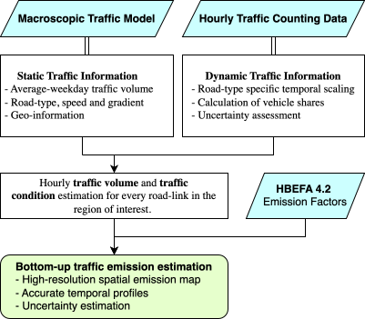

# Data-driven Road-Transport Inventory for Vehicle Emissions (DRIVE)<br>

Python framework to calculate road traffic emissions in urban areas. It scales a static macroscopic traffic model (average weekday traffic per road link) with hourly, vehicle-class-specific data from traffic counting stations, and combines this activity with [HBEFA 5.1](https://www.hbefa.net/) emission factors for hot exhaust, non-exhaust and cold start excess emissions.

With DRIVE you can:

- estimate a high-resolution spatial emission map for road transport (line sources and gridded);
- generate data-based temporal profiles for greenhouse gases and air pollutants (hourly, per road type and vehicle class);
- compute vehicle-kilometres per road type, level of service and vehicle class.

The project is part of [**ICOS Cities**](https://www.icos-cp.eu/projects/icos-cities), funded by the European Union's Horizon 2020 Research and Innovation Programme under grant agreement No. **101037319**.

<br>



## How to use DRIVE

The current version is the `drive` Python package (branch `v2`). It is driven by one YAML configuration and two commands: `drive ingest` loads the source data into a versioned DuckDB store, and `drive run` computes the emissions from the store. The Jupyter notebooks of the first version are kept for reference, see [Version 1](#version-1-notebooks).

> **_IMPORTANT:_** The traffic model, the city's counting data and HBEFA need licences and are not part of this repository. Check the data requirements in the [data folder](/data/README.md) first.

### Setup

[`uv`](https://docs.astral.sh/uv/getting-started/installation/) manages the dependencies (Python ≥ 3.13). Run `uv sync` in the repository to create the environment, then run every command with `uv run`.

### Configuration

One YAML file describes a city and a run. [`configs/munich_2025.yaml`](configs/munich_2025.yaml) is the Munich configuration. Its sections:

| Section | Content |
|---|---|
| `paths` | `data_root` (relative to the config file), the store and the results folder (relative to `data_root`) |
| `traffic_models`, `visum` | the VISUM link and zone exports per model, and how their road types map to HBEFA |
| `ingest` | the sources of every `drive ingest` command: LHM and BASt counts with their detector-link matching, HBEFA tables (files or web API), calendar, DWD weather stations, VG250 boundaries |
| `run` | traffic model, period, reference year, HBEFA version, vehicle classes, components, ambient temperature, clip area (AGS) |
| `counts_qa` | counts period, quality thresholds, BASt flags, counter link overrides |
| `kernel`, `cold_start` | level-of-service thresholds, car units, cold start settings |
| `vehicle_share_pools`, `scaling_road_types` | pooled vehicle shares, and road types scaled like another road type |
| `outputs` | the grids for gridded emissions |

Every path except `data_root` is relative to `data_root`. The HBEFA web API needs credentials in the environment or in an `.env` file (`HBEFA_EMAIL`, `HBEFA_PASSWORD`, see `notebooks/data_preprocessing/.env.example`).

### Load the data into the store

```bash
uv run drive ingest visum configs/munich_2025.yaml        # traffic model links and zones
uv run drive ingest lhm configs/munich_2025.yaml          # city detector exports
uv run drive ingest bast configs/munich_2025.yaml --download   # BASt stations: annual files and raw archives
uv run drive ingest hbefa configs/munich_2025.yaml        # emission factors (--download: from the HBEFA web API)
uv run drive ingest calendar configs/munich_2025.yaml     # public and school holidays
uv run drive ingest meteo configs/munich_2025.yaml        # DWD hourly temperatures
uv run drive ingest boundaries configs/munich_2025.yaml --download   # BKG VG250 boundaries
```

- **Versioning:** every ingest writes a new store batch only if its input changed, so it can be re-run at any time. `drive ingest bast --download` is meant for a monthly cron job.
- **Reproducing a run:** set `run.data_version` to a store batch id. Empty means the latest batch.

### Compute the emissions

```bash
uv run drive run configs/munich_2025.yaml              # one year, as set in `run`
uv run python scripts/run_series.py                    # 2018-2025 on the 2019 model and 2025 on the 2025 model
```

A run of one year takes about 40 s. It writes, to `data/inventory/v2/`:

| File | Content |
|---|---|
| `linesource_<stem>.gpkg` | Line sources, layers `hot` and `cold`: g/km per link piece and vehicle-km |
| `grid_<name>_<stem>.gpkg` | Emissions per grid cell (TNO 100 m and 1 km), layers `hot`, `cold`, `total`, in kg |
| `summary_<stem>.csv` | Tonnes per road type, vehicle class and component |
| `vkt_<stem>.csv` | Vehicle-km per road type, level of service and vehicle class |
| `*_profile_<stem>.parquet`, `*_timeprofile_<stem>.csv` | Hourly emissions and temporal profiles |

See [docs/outputs_README.md](docs/outputs_README.md) for units and details.

### Documentation

| Page | Content |
|---|---|
| [docs/v2_pipeline_README.md](docs/v2_pipeline_README.md) | The whole chain as flow charts: ingest, counts QA, activity, kernel, cold starts, outputs |
| [docs/vehicle_classes_README.md](docs/vehicle_classes_README.md) | Vehicle classes per source, the class split, share corrections and their reasoning |
| [docs/hot_emission_factors_README.md](docs/hot_emission_factors_README.md) | Selection of the hot emission factors, ambient temperature |
| [docs/day_grouping_README.md](docs/day_grouping_README.md) | Day types and how they are used |
| [docs/bast_counts_README.md](docs/bast_counts_README.md) | BASt sources, formats, flags, and their use in the counts QA |
| [docs/outputs_README.md](docs/outputs_README.md) | Output files, units, gridding |
| [tests/README.md](tests/README.md) | The tests and what each one guards against |

### Checks

- `uv run pytest`, `uv run ruff check` and `uv run pyright` run in CI on every push.
- `scripts/compare_v1_*.py` compare the results with frozen version 1 baselines; they need the restricted data.
- `scripts/check_link_shares.py` compares counted and modelled volumes and shares per counting station.

## Version 1 (notebooks)

The first version of DRIVE runs as Jupyter notebooks (`notebooks/`, modules in `utils/`, paths in `utils/data_paths.py`). It is kept for reference and for the comparison scripts; new work happens in the `drive` package. See the [notebooks folder](/notebooks/README.md).

## Related Work
Kühbacher, D., Aigner, P., Super, I., Droste, A., Denier van der Gon, H., Ilic, M., and Chen, J.: Bottom-up estimation of traffic emissions in Munich based on macroscopic traffic simulation and counting data, EGU General Assembly 2023, Vienna, Austria, 24–28 Apr 2023, EGU23-12997, https://doi.org/10.5194/egusphere-egu23-12997, 2023.

## Contributors
Daniel Kühbacher (Lead) [@DanielKuebi](https://github.com/DanielKuebi)<br>
Ali Ahmand Khan [@alimayo](https://github.com/orgs/tum-esm/people/alimayo)<br>
Julian Bärtschi [@jbaertschi](https://github.com/jbaertschi)
