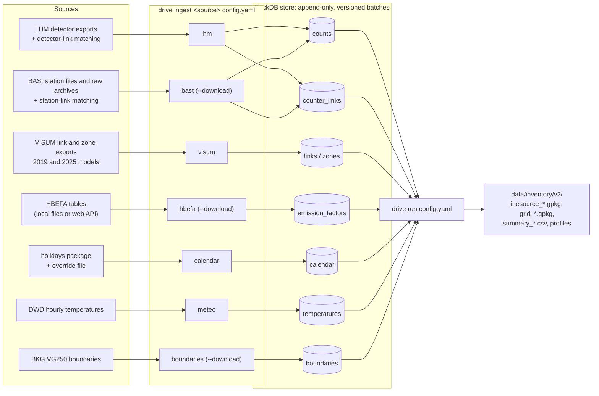
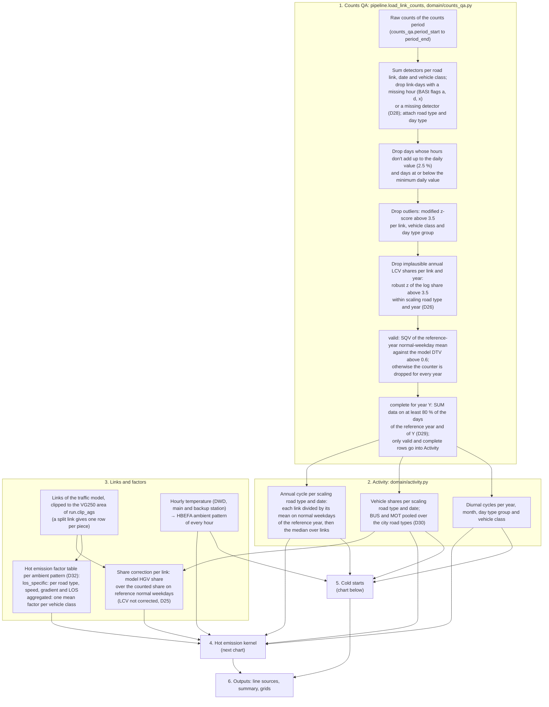
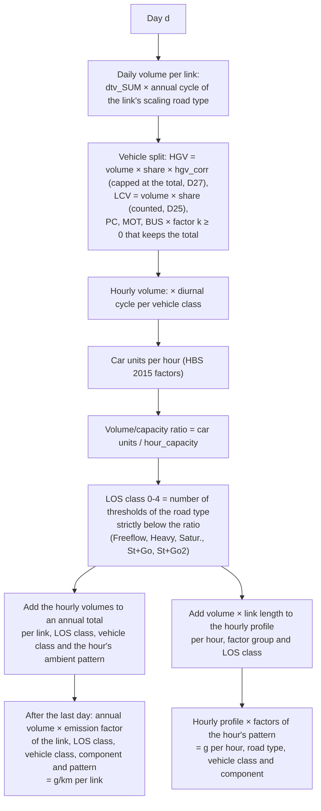
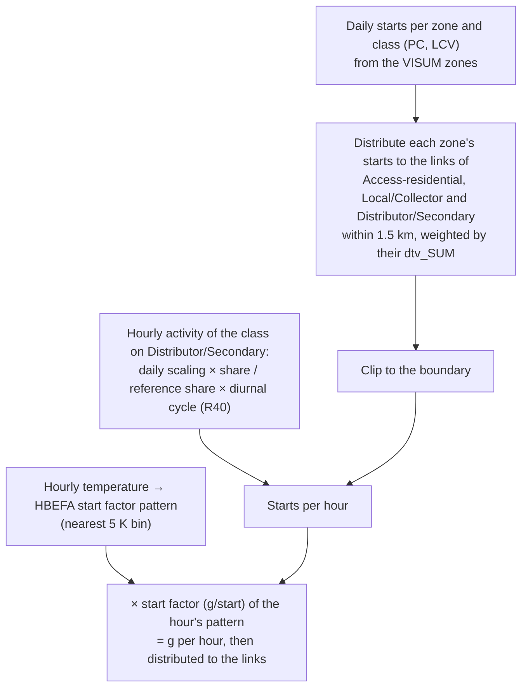

# DRIVE v2: how the emission chain works

This page shows the current logic of the `drive` package (branch `v2`) as flow charts. It covers the whole chain from the source data to the output products:

- **Hot emissions:** exhaust and non-exhaust.
- **Cold start excess emissions.**
- **Outputs:** line sources, summary tables and gridded emissions.

Details are in the topic pages linked below. Decisions (D…) and backlog items (R…) refer to the v2 spec.

## Overview

Ingest commands load each source into one DuckDB store. `drive run` reads only the store and writes the results.

- **Versioning:** every ingest writes a new batch only if its input changed. A run reads the store as of `run.data_version` (a batch id or a time stamp; empty means the latest batch), so it can be reproduced later.
- **Counter link overrides:** corrections of the manual detector -> link matching are kept in git in `configs/counter_link_overrides.csv`, one row per detector with a reason (move to another link, or exclude; optionally per traffic model). They are applied when a run reads the matching (`pipeline.load_counter_links`, spec R26). Today: BASt 97742 moved to the eastbound carriageway 48217.
- **BASt sources:** the counts come from the annual station files for 2018–2020 and from the raw archives from 2021 on. `drive ingest bast --download` is meant for a monthly cron job. See [bast_counts_README.md](bast_counts_README.md).

## `drive run`: from counts to emissions

Topic pages:

- [day_grouping_README.md](day_grouping_README.md): which days are normal weekdays (the scaling reference), and how days are grouped for the diurnal cycles, gap filling and outlier checks.
- [vehicle_classes_README.md](vehicle_classes_README.md): the vehicle classes of each source, the split of a link's volume into classes, the share corrections, the pooled BUS and MOT shares, the LCV share check and the HGV cap.
- [bast_counts_README.md](bast_counts_README.md): BASt sources, formats, flags, and how the counts QA uses the flags.
- [hot_emission_factors_README.md](hot_emission_factors_README.md): selection of the hot factors, including the hourly ambient temperature.

## The kernel, one day at a time

`domain/kernel.py:hot_emissions` loops over the days of the year. Within a day, all links and hours are computed at once with NumPy.

- **Speed:** emissions are linear in volume, and a link's factor depends only on its LOS class and the hour's ambient pattern. So the kernel only sums volumes per LOS class and pattern during the loop, and applies the factors once at the end. A year takes about 20 s, instead of v1's 46 min.
- **Ambient pattern:** only NOx and NO2 of PC and LCV depend on it. `run.hot_ambient: fixed` with `T+25°C,tØ,dØ` reproduces v1.
- **Errors and reports:** the kernel stops with an error before computing if a factor is missing, and on any day with missing or NaN activity. It reports the links on which the HGV cap acted.

## Cold starts

`pipeline.compute_cold_emissions`, `domain/cold_start.py`:

## Outputs

`drive run` writes, per run, line sources and a summary table:

- `linesource_<stem>.gpkg`: layers `hot` and `cold`, g/km per link piece.
- `summary_<stem>.csv`: t per kind, road type, vehicle class and component.

For each grid in `outputs.grids` (TNO 100 m and 1 km), it also writes `grid_<name>_<stem>.gpkg`, with layers `hot`, `cold` and `total` in kg per cell and component. Hourly profiles and time-profile factors are written as before. All products add up to the same totals. See [outputs_README.md](outputs_README.md).

## Settings per traffic model

The VISUM models represent the average normal-weekday traffic of their year, so each model is scaled relative to the normal weekdays of its own year. `scripts/run_series.py` sets this per run (D31). 2025 is computed with both models, so their estimates for the same year can be compared.

| Years | Traffic model | Reference year | Counts period |
|---|---|---|---|
| 2018–2025 | `visum2019` | 2019 | 2018–2025 |
| 2025 on | `visum2025` | 2025 | 2019–2025 |

Known caveat: in 2018 most city detectors only report from December. The 2018 scaling of the city road types therefore rests on 1–4 counters (R47).

## Checks

| What | How |
|---|---|
| Kernel, scaling, vehicle split, pooling, counts QA, gridding, output units, store versions | `uv run pytest`, known-answer tests on invented data (`tests/`), also in CI |
| Code | `uv run ruff check`, `uv run pyright`, also in CI |
| Results against v1 | `scripts/compare_v1_*.py` on the real data, against the baselines in `data/inventory/baselines/`; local only. They stay exact on v1's own inputs and report the differences of the v2 chain |
| Counted vs modelled shares per counted link | `scripts/check_link_shares.py [config] [scaling road type]` |
| Whole series | `scripts/run_series.py`, compared with the latest baseline (currently `v2.10-counteroverrides`) |
| Output contracts | `drive/schemas.py` (line sources, summary, grids, profiles: keys, CRS EPSG:25832, finite values, hot ≥ 0, naive local hours), checked whenever `drive run` writes |
